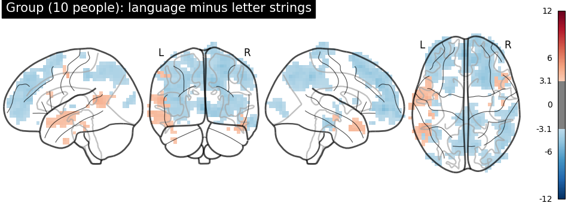

# fmri-language-localizer
Nilearn first- and second-level fMRI analysis of a language localizer (language vs letter strings), run in Google Colab

# fMRI Language Localizer (Nilearn)

**Question:** Which brain regions respond more strongly to language than to letter strings, and are they stronger in the left hemisphere?

## Data
The Nilearn fMRI language localizer demo dataset: 10 participants, with preprocessed scans in BIDS format. Each person completed a block-design task alternating 12 blocks of language and 12 blocks of letter strings (about 7 seconds per block). The scanner took one whole-brain image every 1.5 seconds (229 images, about 5.7 minutes).

## Method
Run in Google Colab with Nilearn:
- First-level GLM for each participant (language minus letter strings), with 8 mm smoothing and six head-motion regressors
- Second-level group model across all 10 participants
- Glass-brain visualization thresholded at uncorrected p < .001
- Rough hemisphere comparison: count of voxels above threshold in the left vs. right hemisphere

## Result
Language-selective activation was concentrated in the left hemisphere, especially along the temporal lobe and toward the back of the brain. About 84% of voxels passing threshold (213 left, 42 right) were in the left hemisphere.

## Limitations
- Small demo dataset (10 people)
- Uncorrected p < .001 threshold, with no correction for multiple comparisons
- The hemisphere comparison is a descriptive voxel count, not a formal lateralization test
- Preprocessing was done in advance as part of the dataset
- The group map also shows broad letter-string-greater-than-language effects in frontal and parietal areas that I did not investigate

## Files
- `fmri_language_localizer.ipynb`: full analysis notebook (opens in Colab)
